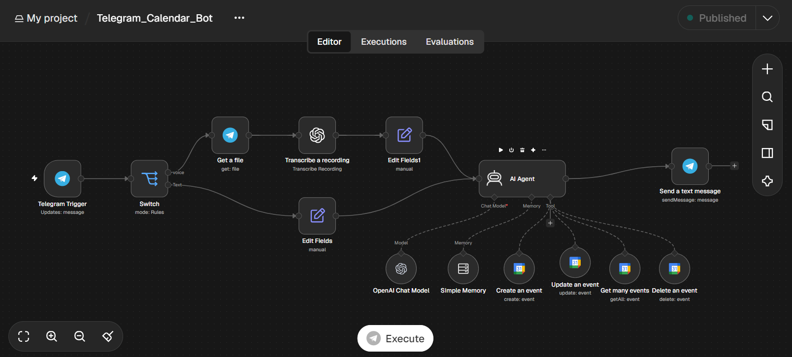
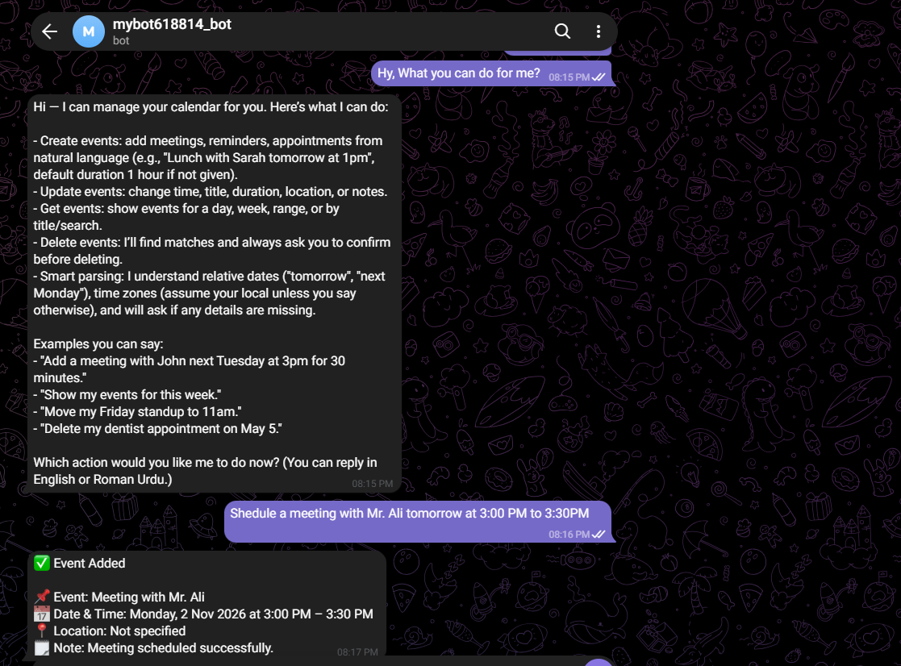
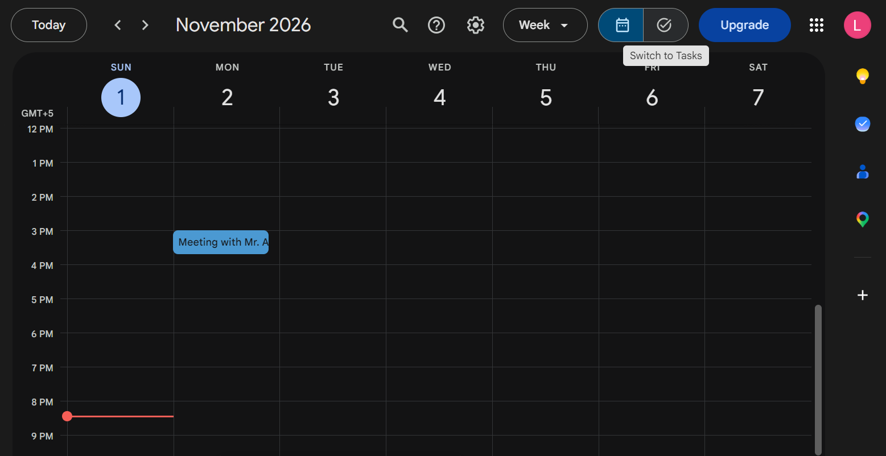

# AI Telegram Calendar Bot — n8n Workflow

A conversational Google Calendar assistant built with n8n. Send a **text or voice message** to a Telegram bot, and an AI agent creates, updates, searches, or deletes your calendar events — no app switching, no manual entry.

**English and Roman Urdu supported.**

---

## What It Does

```
Telegram message (text or voice)
            ↓
   Voice? → Download → Whisper transcription
   Text?  → pass through
            ↓
   AI Agent (GPT-5-mini + memory)
            ↓
 ┌────────┬─────────┬────────┬────────┐
 ↓        ↓         ↓        ↓
Create   Update     Get    Delete
event    event     events  event
(Google Calendar)
            ↓
   Confirmation sent back on Telegram
```

**Just talk to it. Your calendar updates itself.**

---

## Features

| Feature | Description |
| --- | --- |
| Create events | "Lunch with Sarah tomorrow at 1pm" — defaults to 1 hour if no duration is given |
| Update events | Change title or time of an existing event |
| Get events | Show events for a day, week, or date range (defaults to today) |
| Delete events | Finds matches first and **always asks for confirmation** before deleting |
| Voice messages | Voice notes are transcribed with OpenAI Whisper and handled like text |
| Natural dates | Understands "tomorrow", "next Monday", "Friday at 3pm" |
| Conversation memory | Remembers the last 20 messages per chat |
| Bilingual replies | Replies in English or Roman Urdu, matching the user |

---

## Tech Stack

| Tool | Purpose |
| --- | --- |
| n8n | Workflow automation |
| Telegram Bot API | Chat interface (text + voice) |
| OpenAI GPT-5-mini | AI agent / reasoning |
| OpenAI Whisper | Voice-to-text transcription |
| Google Calendar | Event storage |

---

## Workflow Overview

```
[Telegram Trigger] → [Switch] ─ voice → [Get a file] → [Transcribe] → [Edit Fields1] ─┐
                              └ text  → [Edit Fields] ────────────────────────────────┤
                                                                                      ↓
                                                  [AI Agent] ← Chat Model + Memory + 4 Calendar tools
                                                      ↓
                                            [Send a text message]
```

**14 nodes. Fully automated. Runs 24/7.**

---

## Example Commands

```
Add a meeting with John next Tuesday at 3pm for 30 minutes
Show my events for this week
Move my Friday standup to 11am
Delete my dentist appointment on May 5
```

You can also send any of these as a voice note.

---

## Setup

### 1. Create a Telegram Bot

Message [@BotFather](https://t.me/BotFather) on Telegram → `/newbot` → copy the **bot token**.

### 2. Import Workflow

Open n8n → **Import from file** → select `workflow.json`

### 3. Add Credentials

| Credential | Where to get |
| --- | --- |
| Telegram API (bot token) | @BotFather |
| OpenAI API Key | platform.openai.com |
| Google Calendar OAuth2 | Google Cloud Console |

Credentials are stripped from the exported file, so after import open each node and select your own credentials.

### 4. Configure Nodes

- **Telegram Trigger / Get a file / Send a text message** — select your Telegram credential
- **OpenAI Chat Model / Transcribe a recording** — select your OpenAI credential
- **Create / Update / Get / Delete an event** — select your Google Calendar credential and pick your calendar (the file contains the placeholder `YOUR_CALENDAR_EMAIL@gmail.com`)
- **Workflow settings** — set your time zone so relative dates resolve correctly

### 5. Activate

Toggle the workflow **Active**, open your bot in Telegram, and say hi.

---

## Screenshots

**Workflow**



**Telegram conversation**



**Event in Google Calendar**



---

## Known Limitations

- The create/update tools currently send only title, start, and end to Google Calendar. Location and notes are not saved yet.
- Update and delete rely on the agent calling "Get events" first to find the event ID.
- Memory is in-process (Simple Memory) and resets when n8n restarts. Swap in Postgres/Redis memory for persistence.

---

## Use Cases

- **Busy professionals** — schedule meetings hands-free by voice
- **Freelancers** — manage client calls from one chat
- **Teams in Pakistan and beyond** — Roman Urdu friendly
- **Starter template** — extend with reminders, daily agenda push, or multi-calendar support

---

## License

MIT — free to use and modify.
